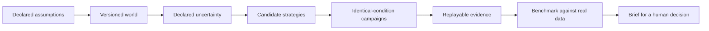
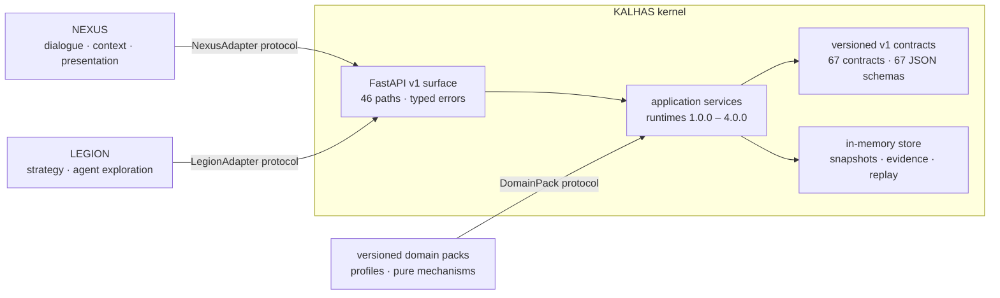

<div align="center">


# KALHAS

A domain-neutral Python kernel for comparing strategies in reproducible simulations under declared uncertainty.

[](https://github.com/Encomm-Tensor-Intelligence/Encomm_Kalhas/actions/workflows/ci.yml)
[](https://docs.astral.sh/uv/)
[](#where-it-stands-today)
[](#testing-and-verification)
[](#testing-and-verification)
[](#testing-and-verification)
[](#testing-and-verification)
[](#why-trust-the-results)

</div>

## What is KALHAS?

KALHAS does not predict one future. It constructs bounded, reproducible possible worlds, tests strategies under identical declared uncertainty, and identifies which decisions remain robust across recorded assumption variants.

A world is a recorded model of a situation, including its assumptions. For a
fictional flood, a user might compare evacuation, shelter and supply strategies
across the same possible flood scenarios. A seed is a recorded input that fixes
how a simulation draws its uncertainty; each strategy is tested with the same
worlds and seeds. The comparison can truthfully be `inconclusive`.

Runtime evidence is empirical and evidence-based under declared models and
recorded assumptions — not calibrated and not certainty. It performs no autonomous live action.
The kernel is domain-neutral: domain concerns enter through explicitly supplied
versioned domain packs, not domain-specific kernel logic.

## How it works

The diagram shows the intended path from a declared model to evidence for a
human. The simulation and benchmark facilities exist, but Model Pack step
results are not yet connected to campaign outcomes or decision briefs.



## Where it stands today

A holdout is data reserved for a later evaluation, kept separate from fitting
and selection. The current holdout is sealed.

| Area | Status | What that means |
| --- | --- | --- |
| Deterministic kernel and exact replay | Working | Recorded inputs and conditions can reproduce completed runs. |
| Adaptive runtime `4.0.0` | Working | Recorded observations and bounded policies support replayable adaptation. |
| Model Pack foundation and KALHAS-PAN v0.1 | Working synthetic reference | `experimental`, with no benchmark evidence; the synthetic fixture `kalhas-conformance-stockflow` is `conformance_only`. |
| Real-data chain | Working on one disease dataset | ECDC data has raw, curated, split and locked protocol artifacts; Eurostat population data is also stored separately. |
| Reference baselines and exact scoring | Working | Baseline forecasts and scores exist for `development` and `validation`. |
| Holdout | Sealed | Reserved for a separately authorized evaluation; it has not been evaluated. |
| PAN forecasts on real data | Not started | No PAN mechanism forecast has been evaluated against the benchmark. |
| Second pathogen and leave-one-pathogen-out evaluation | Decided, not started | ADR-011 sets the rules; a second pathogen dataset and the evaluation remain future work. |
| Persistence, multi-user operation and deployment | Not implemented | The kernel uses an in-memory local store. |
| External scientific review | Not done | No external domain or statistical review supports the current pack claims. |

## First real-data results

The ECDC COVID-19 hospital and ICU bundle was evaluated under protocol
`ecdc-covid19-hospital-icu-primary-benchmark` `1.0.0`. This is a sanity
benchmark between a point persistence baseline and a quantile persistence
reference; it is not evidence about PAN or any Model Pack. Weighted interval
score (WIS) measures forecast error and interval quality; relative WIS compares
candidate and reference scores on the same tasks, with lower values better.

| Partition | Tasks per set | Cells | Verdicts | Relative WIS range | Reference 95% coverage range | Fallback tasks |
| --- | --- | --- | --- | --- | --- | --- |
| development | 61132 | 16 | 16 fail | 1.549059 to 1.675262 | 0.740612 to 0.868811 | 751 |
| validation | 13280 | 16 | 16 fail | 1.637843 to 1.825789 | 0.825926 to 0.925558 | 2 |

The `fail` verdicts are largely by construction: the point baseline has
zero-width intervals, so its WIS equals its absolute error. The reference is
under-dispersed on these data: its intervals cover less than their nominal
level in every cell. The holdout was not evaluated.

See [benchmarks](benchmarks/README.md) for the protocol, results and limits,
and [datasets](datasets/README.md) for sources, terms and required attribution.
The data in this repository carries its publishers' terms and acknowledgements.

## Why trust the results

- **Versioned contracts.** Public v1 contracts are frozen when shipped and have
  synchronized JSON schemas; breaking changes require a new version.
- **Exact replay.** A completed run can be replayed against recorded input and
  event hashes. Strategy comparisons use identical recorded conditions.
- **Immutable evidence.** Executions, observations, decisions and switch
  events are content-hashed and can be independently re-derived.
- **Integrity checks.** Tampered inputs, forged evidence and identity mismatches
  are rejected rather than silently repaired.
- **Preregistration.** The split and protocol are locked by hashes; the holdout
  remains sealed. Baselines are verified by re-execution, and failed verdicts
  are retained in score reports.
- **Local operation.** The running application makes no network or provider calls
  and performs no real-world effects.

These checks establish reproducibility and integrity under declared assumptions;
they do not establish empirical adequacy or scientific validity.

## Capabilities at a glance

| Area | What it provides |
| --- | --- |
| Contracts and lifecycle | 67 versioned v1 contracts, canonical serialization, content hashes and a campaign lifecycle state machine |
| World models | Immutable world versions, domain-pack bindings, uncertainty declarations and deterministic realizations |
| Campaign runtime | Structural, realization-aware (`3.0.0`) and adaptive (`4.0.0`) deterministic runtimes with exact replay |
| Evidence | Observations, empirical outcome distributions, objective evaluations and verified projections |
| Decision support | Paired same-seed comparisons, regret, robustness, Pareto evidence and deterministic briefs |
| Model Packs | A generic mechanism boundary, synthetic KALHAS-PAN reference and a 13-entry catalogue; catalogue entries do not add capabilities |
| Offline datasets and benchmarks | Hash-bound raw and curated data, locked split and protocol, baseline forecasts and exact scores |
| API | FastAPI v1 surface: 46 paths and 57 operations, typed errors and OpenAPI docs |
| Observability | Operational activity feed and an optional local synthetic Colony UI |

## Architecture

| Role | Owns |
| --- | --- |
| **NEXUS** | Natural-language dialogue, organizational context, memory, presentation |
| **LEGION** | Strategy and agent exploration |
| **KALHAS** | Versioned world models, uncertainty, deterministic simulation campaigns, evidence, replay |

These three roles are the only components in this architecture (see
[AGENTS.md](AGENTS.md)). KALHAS couples to the other two solely through the
placeholder adapter protocols in `kalhas/adapters/`.

ARCHITECT names the wider programme combining NEXUS, LEGION, KALHAS and a
planned scientific-evaluation system, EUCLIDES. EUCLIDES is not a KALHAS
component and is not integrated today.




## Quick start

Requires [uv](https://docs.astral.sh/uv/) (which provisions Python 3.12 and
the virtual environment itself).

```bash
git clone https://github.com/Encomm-Tensor-Intelligence/Encomm_Kalhas.git
cd Encomm_Kalhas
uv sync --python 3.12
uv run uvicorn kalhas.api.app:create_app --factory --host 127.0.0.1 --port 8000
```

Then open <http://127.0.0.1:8000/docs> for the interactive OpenAPI surface.

> If a globally set `PYTHONPATH` shadows the project venv (`ModuleNotFoundError`
> on `uv run`), clear it first: `unset PYTHONPATH` (bash) or
> `Remove-Item Env:PYTHONPATH` (PowerShell).

## Minimal local example

With the server running:

```bash
curl -s http://127.0.0.1:8000/health
curl -s -H "X-Tenant-ID: tenant-1" http://127.0.0.1:8000/v1/system-info
```

The health endpoint checks the local service; system information uses the
specified tenant. API errors use a typed shape with `code`, `message`, `details`
and `request_id`. The architecture guides and tests show complete lifecycles.

## KALHAS Lab (local)

Run the separate local app with:

```bash
uv run uvicorn kalhas_lab.app:create_lab_app --factory --host 127.0.0.1 --port 8000
```

Open http://127.0.0.1:8000/lab/. It runs the real kernel with synthetic inputs and local mocks; it is not a forecast or recommendation.

## Testing and verification

```bash
uv run pytest                              # full suite
uv run ruff check .                        # lint
uv run ruff format --check .               # formatting check
uv run mypy kalhas tests                   # strict type check
PYTHONPATH= uv run python scripts/export_schemas.py --check   # schema sync
PYTHONPATH= uv run python scripts/export_model_pack_artifacts.py --check   # model pack sync
PYTHONPATH= uv run python scripts/verify_dataset_bundles.py --check   # dataset bundle check
```

CI runs the full suite on every push to `main` and on pull requests targeting
`main`. `make check` runs lint, formatting, types and tests where GNU make is
available; use the commands above for the artifact checks.

## Roadmap

These are plans and evidence gates, not claims that the work is complete.

| Phase | Planned work |
| --- | --- |
| 30 | Historical benchmarking: extend the benchmark chain to PAN authoring, a second pathogen, calibration and sealed-holdout evaluation, under preregistered rules. |
| 31 | Local integration of NEXUS, LEGION and KALHAS through versioned contracts, with conformance fixtures. |
| 32 | A durable local platform: persistent storage, background jobs and crash recovery, with replay unchanged. |
| 33 | Scientific validation: sensitivity and identifiability analysis, uncertainty classes, and independent domain and statistical review. |
| 34 | Generalization and hardening: a second scenario, one substantive non-health pack, planned as MARITIME-TRADE, then fuzzing, cross-platform replay and a threat model. |
| 35 | A research release candidate that partners and reviewers can evaluate and reproduce. |

The catalogue does not implement post-quantum cryptography (PQC) or a
variational quantum eigensolver (VQE); catalogue entries are plans, not packs.
See the [catalogue](docs/model-packs/README.md) and
[decisions](docs/decisions/) for their scope and gates.

## Documentation

| Document | Contents |
| --- | --- |
| [AGENTS.md](AGENTS.md) | Repository rules and gates |
| [Architecture](docs/architecture/README.md) | Layer map and dependency rules |
| [Contracts and lifecycle](docs/architecture/contracts-and-lifecycle.md) | Contract versions, lifecycle and hash discipline |
| [Decisions](docs/decisions/) | Architecture decision records |
| [Model Packs](docs/model-packs/README.md) | Maturity, catalogue and regeneration |
| [Datasets](datasets/README.md) | Sources, terms, attribution and dataset bundles |
| [Benchmarks](benchmarks/README.md) | Locked protocol, reference results and limitations |
| [CHANGELOG.md](CHANGELOG.md) | Release and checkpoint timeline |
| [CONTRIBUTING.md](CONTRIBUTING.md) | Contribution workflow and gates |
| [SECURITY.md](SECURITY.md) | Scope and security reporting |

## Known limitations and non-goals

- **Local, in-memory kernel.** There is no database, process-independent
  persistence, clustering or multi-user operation.
- **No live actions.** The application performs no autonomous live action.
- **Determinism is not validity.** Replay does not establish scientific
  validity, calibration, certainty or real-world causality. Outputs are not
  real-world recommendations.
- **Synthetic UI.** Colony UI renders mock activity and is separate from the
  verified evidence pipeline.
- **Explicit local packs.** A validated `DomainPack` is supplied explicitly;
  there is no dynamic discovery, plugin loading or provider call.
- **PAN is a synthetic reference.** KALHAS-PAN is `experimental`, with no
  benchmark evidence, empirical adequacy claim or external scientific review.
- **Pack results stop at the runtime boundary.** Mechanism step results are
  not yet consumed by campaign outcomes, objective evaluations or briefs.
- **Catalogue entries are not capabilities.** `catalogued` means a roadmap
  candidate, not an implemented pack.
- **Bounded results.** Benchmark results bind only their exact data vintage,
  geography, horizon and metric, as well as the configuration and claim.
- **No license yet.** No license has been selected; all rights are reserved by
  the repository owner until a license is added.

## Contributing and security

Contributions follow the repository's gate discipline — see
[CONTRIBUTING.md](CONTRIBUTING.md). Behavioral changes ship with tests.
Security scope and responsible-disclosure guidance are in [SECURITY.md](SECURITY.md).
Pull requests and issues use the templates under [.github/](.github/).

<details>
<summary>Release history</summary>

## Phase 30 — in progress

Committed work includes offline ECDC and Eurostat data bundles, curated lineage,
a locked ECDC split and benchmark protocol, exact scoring, reference baselines
and development and validation results. ADR-011 records the PAN authoring and
multi-pathogen evaluation decisions. KALHAS Lab provides a separate local app.

## Phase 26 — published

Empirical campaign outcome distributions: implementation-complete and
gate-verified, committed, and published at
`886f398c288971d612fa57bd1d1e731113a69f72`.

## Phase 27 — published

Evidence-based campaign decision support: implementation-complete and
gate-verified, committed, and published at
`a905d2af6b155a0f2568037e2b0f410b20be8d91`, followed by the Gate 27.1
truthful-baseline closure published at
`777a4472ef0d1edc6d30ce61a05851302b981027` (5,480 tests, 0 failed,
0 skipped).

## Phase 28 — complete and published

Adaptive deterministic runtime `4.0.0`: implementation-complete,
gate-verified, committed, and published at
`f001d5f027cf21e8964eac72f122730e98ebdd3d`. It adds five v1 contracts
(indexes 50–54), five synchronized schema artifacts, three read-only adaptive
API paths, causal observation/decision/switch evidence, and the unpatched
exact-five-plus-adaptive acceptance proof (24 focused tests). The publication
baseline passed 6,850 tests with 0 failures, 0 errors, and 0 skipped.

## Phase 29 — complete and published

Phase 29 is implementation-complete, gate-verified at checkpoint CP29-B,
committed, and published at `b3b19719bc9a7557800584a0d434bca75d7b24a9`. Its
foundation was published at `1e15d14cac1594c1d74d724ce7f1b3cef6ad2609`: six
public v1 contracts (indexes 55–60, 61 total), a pure fail-closed mechanism
dispatcher/Runtime-4 bridge, and the synthetic `KALHAS-PAN` v0.1 reference pack.
The completion work on top of it (slices H29-S07 through H29-S09) adds:

- **Conformance fixture.** `kalhas-conformance-stockflow` 0.1.0 is a tiny
  synthetic, non-health, integer stock-flow fixture under
  `kalhas/domain_packs/conformance_stockflow/`. It is labeled
  `conformance_only`; it is never a product pack, never a portfolio entry, and
  never a substitute for KALHAS-MARITIME-TRADE.
- **Shared-boundary proof.** PAN and the fixture traverse the same generic
  dispatcher and Runtime-4 bridge under one identical authority chain. The
  proof covers exact identities, one invocation per call, deterministic
  evidence, cross-pack fail-closed cases (including a hybrid pack), and
  cross-tenant rejection. There is zero domain-specific kernel change: no
  module under `kalhas/` outside `kalhas/domain_packs/` names either pack.
- **Assurance and catalogue artifacts.** `scripts/export_model_pack_artifacts.py`
  deterministically generates three checked-in artifacts under `model_packs/v1/`
  (two assurance profiles and a 13-entry catalogue), and `--check` verifies
  them like `scripts/export_schemas.py --check`. No runtime surface loads them.
- **Evidence-derived maturity.** PAN is `experimental`, derived only from
  `synthetic_conformance` and `deterministic_execution` evidence; it has no
  benchmark evidence, no external review, and no empirical adequacy claim. The
  fixture is `conformance_only`. The other 12 entries are `catalogued`:
  roadmap candidates only, with no implemented capability. Their list order is
  not a delivery order, and only PAN (Phases 29–35) and MARITIME-TRADE
  (34A–35) have a planned wave; the rest are `post-35`.

See [`docs/model-packs/README.md`](docs/model-packs/README.md) for the catalogue.

</details>
